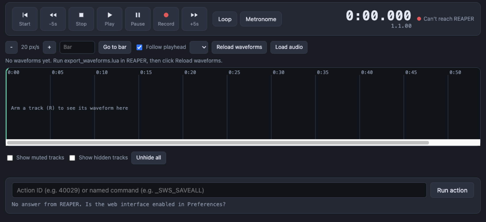

# REAPER Remote

A phone-friendly web remote for [REAPER](https://www.reaper.fm). It runs on REAPER's built-in web interface, so there is nothing to install besides copying two files.

<!-- Add a screenshot here:  -->

## Features

- **Transport**: start, back/forward 5 s, stop, play, pause, record, loop and metronome
- **Timeline**: tap or drag to set the position, then play or record from there. Two-finger pan and pinch to zoom on touch screens
- **Jump to bar**: type `17` or `17.3` (bar.beat)
- **Track controls**: large mute, solo and record-arm buttons for every track in the project
- **Armed-track waveforms**: the timeline shows the waveform of each rec-armed track
- **Track colours and icons** follow the ones set in REAPER
- **Hide and show tracks**: hide muted tracks automatically, or hide any track yourself (page only)
- **Run any action**: type an action ID or a named command

## Install

1. In REAPER, choose **Options > Show REAPER resource path in explorer**.
2. Copy the contents of [`reaper_www_root/`](reaper_www_root) into a folder named `reaper_www_root` there (create it if it doesn't exist).
3. Open **Preferences > Control/OSC/web > Add**, set the mode to **Web browser interface** and keep port 8080. Pick the page under "Default page" if it is listed.
4. Open `http://localhost:8080/reaper-remote.html`. On a phone or tablet on the same network, use `http://<your computer's IP>:8080/reaper-remote.html`.

## Waveforms, colours and icons

REAPER's web interface cannot send audio, so waveforms (and track icons) come from a small script.

1. In REAPER: **Actions > Show action list > New action > Load ReaScript...** and choose `export_waveforms.lua`.
2. Run it. It writes `waveforms.json` and an `icons/` folder into `reaper_www_root`.
3. On the page, click **Reload waveforms**.

Re-run the script after you edit the project. To run it from the page, right-click the action in REAPER's list, choose **Copy selected action command ID**, and paste it into the action box.

## Using it

| Control | What it does |
| --- | --- |
| Tap / drag the timeline | Set the position. Play or Record starts from there |
| Two fingers on the timeline | Pan and pinch to zoom |
| Ctrl/Cmd + wheel | Zoom (desktop) |
| M / S / R | Mute, solo, record-arm the track |
| Eye button | Hide or unhide the track on this page |
| Track name | Select the track in REAPER |
| Space | Play |

## Limitations

- Hiding is done on the page only. REAPER's web interface can't change track visibility, and the page can't see tracks hidden in REAPER.
- Hidden tracks are remembered per browser, by track position. Inserting or deleting tracks can shift which track is hidden. **Unhide all** resets it.
- Waveforms and icons are snapshots from the last export. Only audio items are drawn.
- There are no faders or level meters, and the metronome button doesn't show its state.
- Jump to bar sends a position like `17.1.00` and relies on REAPER recognising it. Please open an issue if it lands somewhere unexpected.

## Security

REAPER's web interface has no login unless you set one. Anyone on your network who can reach the port can control REAPER. Set a username and password in the web interface settings, and don't expose the port to the internet.

## Tested with

<!-- Fill in: REAPER version, operating system, and browsers/devices you tried. -->

## OSC bridge (experimental)

[`osc-bridge/`](osc-bridge) contains an earlier version that talks to REAPER over OSC through a small Node bridge. It is much more limited and kept for reference.

## License

MIT. See [LICENSE](LICENSE). Not affiliated with or endorsed by Cockos Incorporated.
